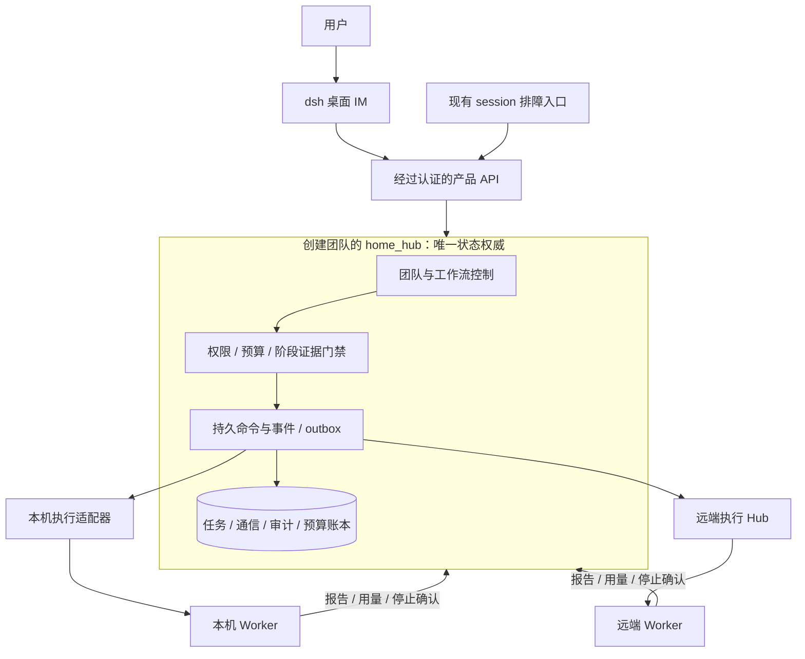
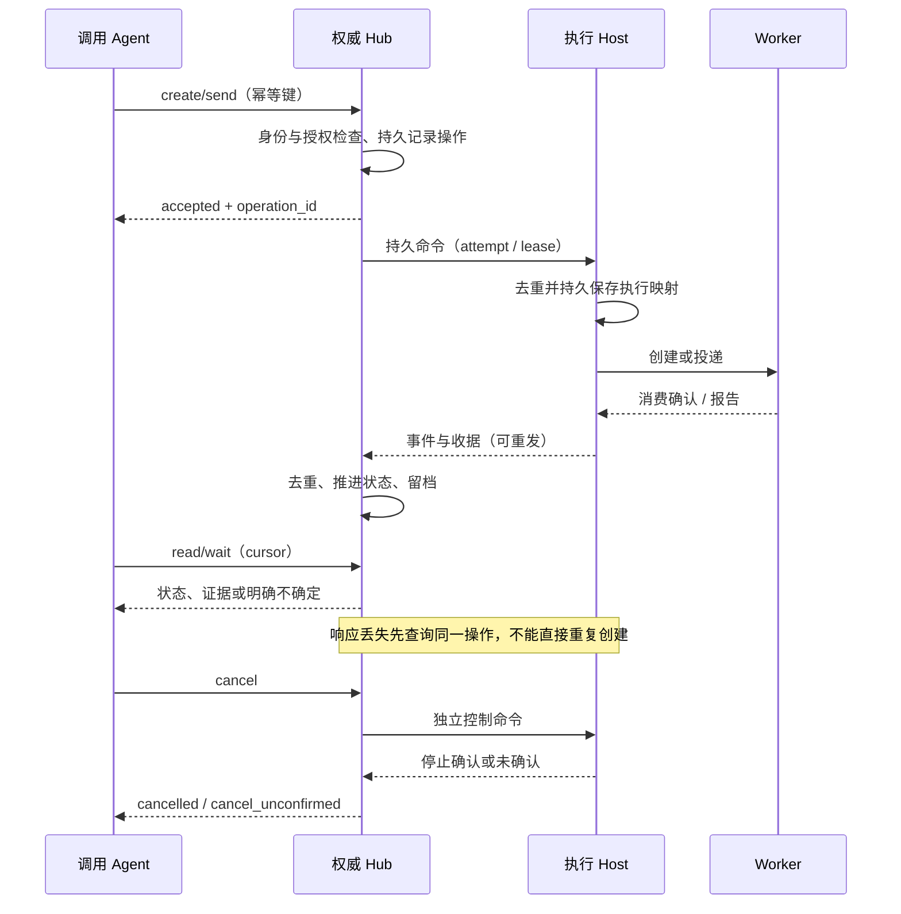
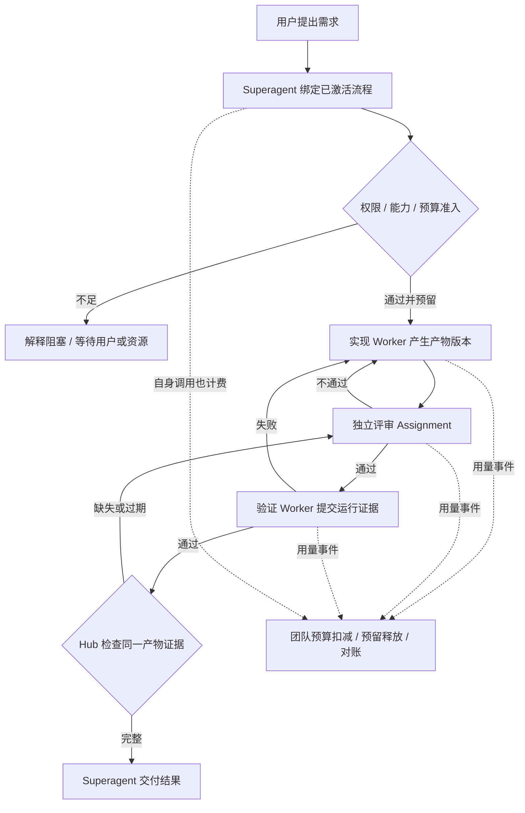

# 架构 Review：通信底座、语言边界与移动端

> 2026-11-01；仅方案。已确认：团队预算、先通信后 IM。用户后续明确 TS 与移动端迁移均后置，当前专注功能。第 2、3 节仅保留前次评估记录，不是当前待办或待决项。

## 1. 推荐架构与边界

home_hub 是逻辑权威，不意味着必须把所有代码放在一个进程或一种语言里。前端、手机、远端均不能绕过它修改任务状态。Coordinator 的模型判断通过同样的命令接口提交；Hub 验证授权和证据，不因模型说“完成”就直接通过。

## 2. 是否全量改为 TypeScript

仓库事实：Rust kode-core 管 PTY/进程与会话，kode-bridge 管 HTTP/WS、跨机通信和 headless 执行，kode-sync-server 管手机镜像与命令路由；dsh 集成已经是 JS，SpecOps 已有 TS/Bun。语言不统一确有接口维护成本，但不是底层缺少可靠投递/取消语义的根因。

| 路线 | 收益 | 代价 / 判断 |
|---|---|---|
| 全量 TS 重写 | 业务/插件语言统一、直接复用部分上游代码 | 同时迁移 PTY、生命周期、SSH、协议、SQLite、GUI/手机接口和发布；行为回归面最大，本期不推荐 |
| Rust 通信/执行 + 新增 TS 编排服务 | 工作流/技能演进贴近 dsh，原生执行保留 | 多一个服务生命周期、RPC、事务边界；值得用小型验证评估，不能免费获得跨进程事务 |
| Rust 继续做权威内核，TS/JS 做策略和插件 | 沿用现有数据库事务、迁移与部署 | Rust 业务代码更多；当前风险最低的基线建议 |

建议先用现有实现完成 P1/P2 并冻结语言无关的操作/事件契约，再评估新增编排模块用 TS 的收益。不要先用 Rust 新写整套业务再无依据重写一次。若选择 TS 权威服务，它必须单独拥有工作流状态、团队预算及命令 outbox 的原子事务；Rust 仅保留执行操作的本地状态。二者以幂等 ID 和恢复协议对接，禁止共同更新同一任务表。跨进程无法原子预留的资源通过有期限预留及补偿处理。

未来完全去掉旧 Tauri/终端产品，会改变迁移收益；若用户明确此方向，应另写迁移 ADR。现在没有停用这些能力的授权。

## 3. 移动端路线

本地 `apps/mobile/README.md` 记录 Flutter 伴侣 App、配对、中心同步和创建会话。该 README 可能落后于实现，不能据其“待做”清单断言代码不存在。

2026-11-01 查询到 [saya-ch/dsh-mobile 项目](https://github.com/saya-ch/dsh-mobile) 自述支持 Android App、iPhone/iPad 主屏幕 Web App、网页推送与移动适配。这是具体社区候选，不能据此声称存在统一的官方原生客户端，也未验证其与本项目 dsh 0.2.1-rc.2 的兼容性。另有同名项目，用户若指定某个产品需给出对应仓库/包名。

建议优先做同一 dsh IM Web 界面的响应式适配，以减少桌面/手机两套业务 UI；移动端复用不要求后端改 TS。服务端执行，手机仅访问和授权，手机切后台不应中断任务。

正式替代 Flutter 前必须核实：认证与设备撤销、现有配对/中心转发协议、桌面不在同一局域网时连接、iOS/Android 支持、后台通知、公开插件槽位、权限交互、历史/断线恢复、版本和许可证。Web 可用不等于原生推送/后台连接已可靠。

建议第一阶段仅评估 Web 路线；保留现有 Flutter。若要求手机首发可用或强制原生通知，列为独立验收范围，不能沿用“移动端不在一期”而暗中排除。

## 4. 通信底座的验收边界

accepted 只说明 Hub 已接收；delivered 是投递到目标；consumed 必须有运行时证据；reported 是任务报告。任务成功还需要流程证据。物理进程创建与落库无法跨系统 exactly-once，崩溃缝隙要靠可发现身份和查询恢复；不能凭“用了 outbox”就宣称永不重复。

P1/P2 的交付不是更多工具名：现有 session 工具即可复现并证明响应丢失、崩溃、重启、断线、迟到、重复、取消与权限拒绝的行为。产品 IM 在这道闸门之后开始。

## 5. 一句话交付与预算流程

图中返工受次数/预算与升级策略约束，不是无限循环。实现变更使旧评审/验证失效。每次阶段派发都重查准入，不能只在整个需求开始时查一次。团队预算与供应商真实余额同时存在时同时约束，界面并列显示来源，缺失真实余额不会伪造一个数。

## 6. 后续确认结果

用户已决定先做功能，TS 和移动端迁移后续再规划。本期不再以这些问题阻塞通信/协作功能设计。

交付终点由团队配置，不写死。研发提供实现→独立评审→验证默认模板；项目工具与代码仓库通过 ProjectBindings 绑定，完成终点通过 DeliveryPolicy 约定。默认模板是建议，核心约束是按已激活流程及授权执行，且完成结论必须有证据。完整契约见 design.md §3.1.1。
